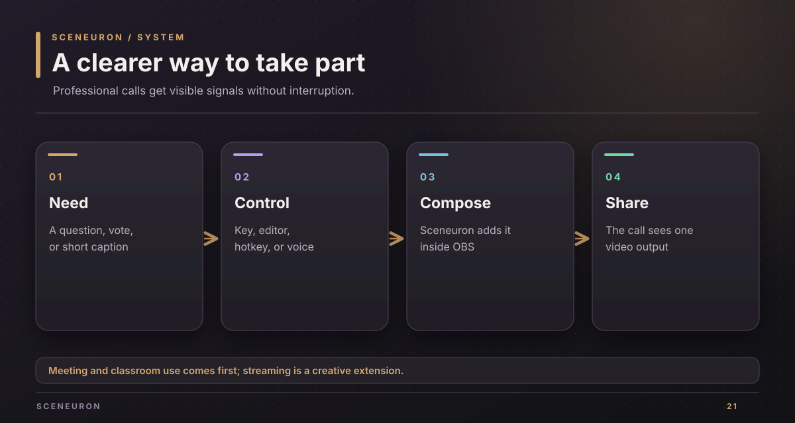
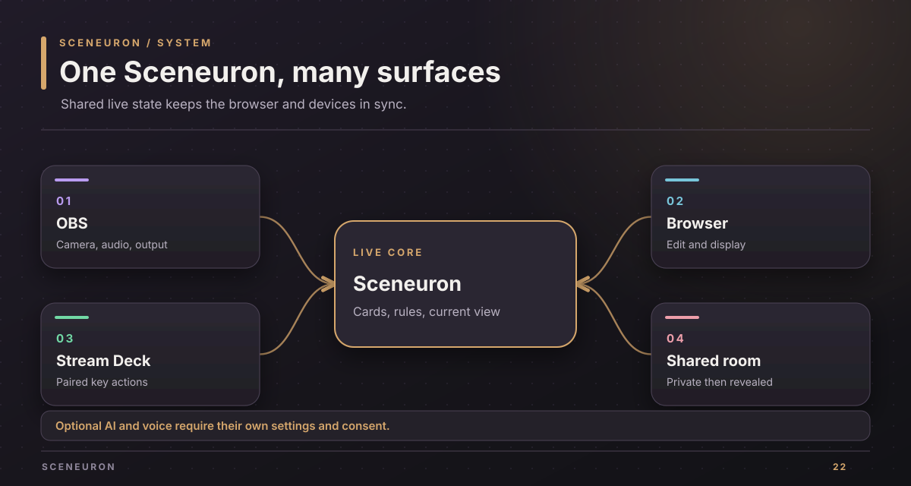
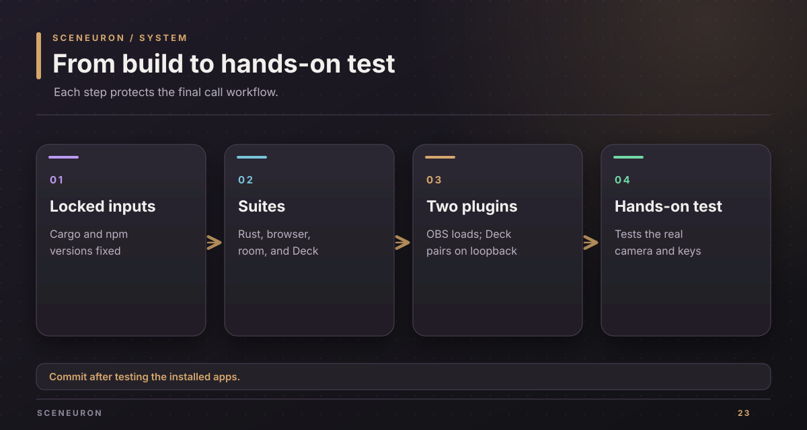

# Sceneuron

Sceneuron puts clear cards, captions, and camera-aware controls into a professional video call through OBS Studio. A streamer can use the same system for expressive overlays and reactions.

## See it without devices or cloud keys

On a Mac with Rust 1.91 or newer, run this from the repository root:

~~~sh
cargo run --locked -p sceneuron-dev -- --port 0 --demo-presence --demo-ai
~~~

Open the Editor URL that the command prints. It serves a simulated camera, microphones, and AI on a free local port. The overlay URL shows the output. No camera image or key leaves the computer in this demo. Stop it with Ctrl-C.

For a real OBS and Stream Deck install, follow the [installation guide](docs/install.md). The current OBS module supports macOS with OBS Studio 31.1 or newer. The optional Stream Deck plugin supports macOS 13 or newer and Stream Deck 7.1 or newer.

## What people can do

| Professional work | Sceneuron control |
| --- | --- |
| Keep a meeting moving | Raise a question, agreement, off-track, or wrap-up card without unmuting. |
| Estimate as a team | Show planning poker values, keep votes hidden, reveal people and values together, then start a new round. |
| Teach or learn in a call | Show a hand-raised, repeat, slower, or answer card in the video. |
| Make speech readable | Put live subtitles and optional translations into the composed output. |
| Keep a consistent layout | Edit text, frames, cards, decks, themes, and rules in the local browser editor. |

A card can be raised from the editor, a Stream Deck key, an OBS hotkey, a configured hand signal, or voice control. The same live state reaches the editor, OBS overlay, and paired controls. The [product brief](docs/project-brief.md) explains the full user path.

## How the parts fit

- The Rust core owns the project, card decks, rules, and current state.
- The OBS plugin supplies camera frames, audio filters, sources, hotkeys, and a local server on `127.0.0.1`.
- The browser editor changes the project. The overlay receives a limited read-only view.
- The Stream Deck plugin pairs once and receives a limited control token.
- A separate SpacetimeDB module holds shared planning poker rooms and keeps votes private until reveal.
- Google Gemini or an OpenAI-compatible endpoint can supply optional camera understanding, plans, and translations. Jev and ElevenLabs are separate optional services.

The [system design](docs/design.md) shows the data flow and token boundaries. The [local HTTP guide](docs/control-api.md) maps integration routes.

## Build and check

The repository has Cargo lockfiles for the main workspace and room module, plus a locked Stream Deck npm package. Run the default local checks from the root:

~~~sh
cargo fmt --all -- --check
cargo test --locked --workspace
cargo clippy --locked --workspace --all-targets -- -D warnings
node --test 'web/tests/*.test.mjs' 'e2e/tests/*.test.mjs'
npm --prefix streamdeck ci
npm --prefix streamdeck test
npm --prefix streamdeck run check
npm --prefix streamdeck run validate
~~~

The [development guide](docs/development.md) adds the room module, browser, Stream Deck, license, and package checks. The [verification guide](docs/verification.md) separates automated evidence from the physical device and call tests.

## Documentation

| Guide | Use it for |
| --- | --- |
| [Documentation map](docs/README.md) | Choose a focused guide |
| [Product brief](docs/project-brief.md) | Professional workflows and creative extensions |
| [System design](docs/design.md) | Components, state, secrets, and rooms |
| [Installation](docs/install.md) | Build, install, pair, verify, and roll back |
| [Development](docs/development.md) | Tools, commands, local tests, and provider setup |
| [Local HTTP API](docs/control-api.md) | Token scopes and control routes |
| [Verification](docs/verification.md) | Automated and hands-on gates |
| [Current backlog](docs/backlog.md) | Remaining work and checks |
| [Demo guide](docs/pitch.md) | A professional-first demo |
| [Provenance](docs/provenance.md) | The owner's account of the plan and implementation |

The owner reports that Alexander Picon spent a couple of hours creating `PLAN.md` with Fable 5.1 on UltraCode. GPT-6-Astra then implemented the plan with ultra effort and ultrafast enabled to meet the deadline. Details are in [provenance](docs/provenance.md).

## License

Sceneuron is proprietary software of Alexander Picon and Chaski AI. [LICENSE](LICENSE) grants no use, copying, modification, or distribution without written permission. Third-party components keep their own licenses. The OBS plugin links libobs, so its current binary is for the owner's own use and demos. See [development](docs/development.md#license-gate) before packaging it for anyone else.

Copyright (c) 2026 Alexander Picon, Chaski AI (https://chaski.ai). All rights reserved.
Proprietary software; see [LICENSE](LICENSE).
