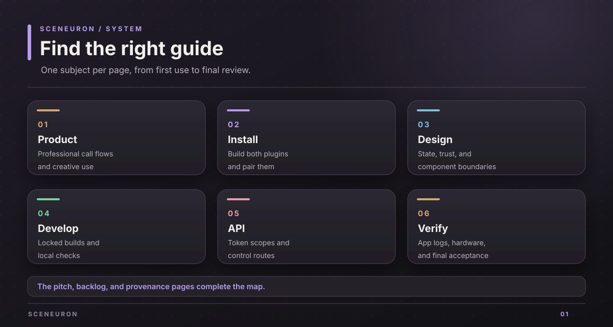

# Sceneuron documentation

Sceneuron helps people communicate during video calls through cards, captions, camera signals, and controls in OBS Studio.

## Choose a path

| I need to... | Start here |
| --- | --- |
| Understand what people can do with Sceneuron | [Product brief](project-brief.md) |
| Build and install both plugins on a Mac | [Installation guide](install.md) |
| Learn how the parts exchange state | [System design](design.md) |
| Work on the code and run checks | [Development guide](development.md) |
| Integrate a local control surface | [Local HTTP API](control-api.md) |
| Check what passed and what still needs a person | [Verification guide](verification.md) |
| See the remaining work | [Current backlog](backlog.md) |
| Present the product in a short demo | [Demo guide](pitch.md) |
| See how the work was made | [Provenance](provenance.md) |

## What runs where

The OBS plugin hosts the engine and a local HTTP server. The editor changes the saved project. The overlay reads a limited view of the live state. The Stream Deck plugin uses a paired control token to raise cards and operate selected controls. A separate SpacetimeDB module supports shared planning poker rooms.

The current OBS build targets macOS. Stream Deck is optional. Local cards, rules, and controls work without an AI key. Camera understanding, cloud speech, and translated subtitles require their own settings and consent.

## Read the evidence

Each guide names the source files or commands behind its claims. Start with the [verification guide](verification.md) before treating an installed plugin as ready for a live call. The physical camera, microphone, OBS scene, and Stream Deck are the final manual checks.

Copyright (c) 2026 Alexander Picon, Chaski AI (https://chaski.ai). All rights reserved.
Proprietary software; see [LICENSE](../LICENSE).
