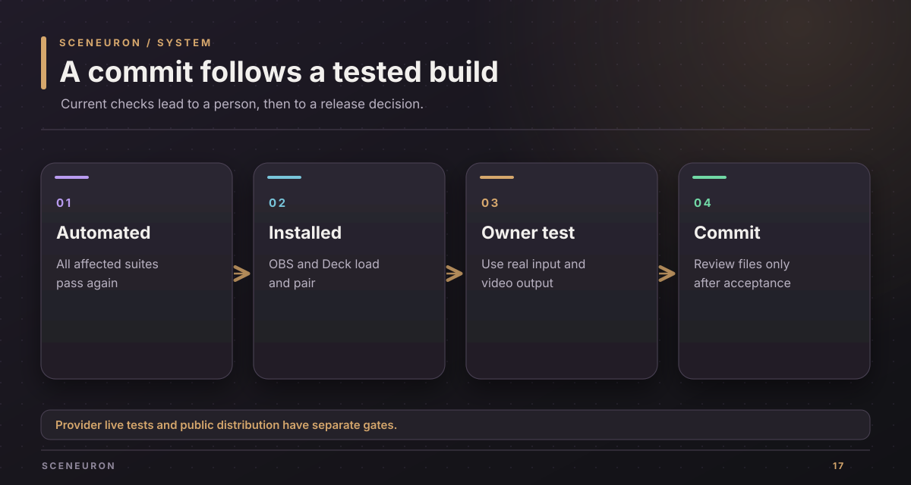
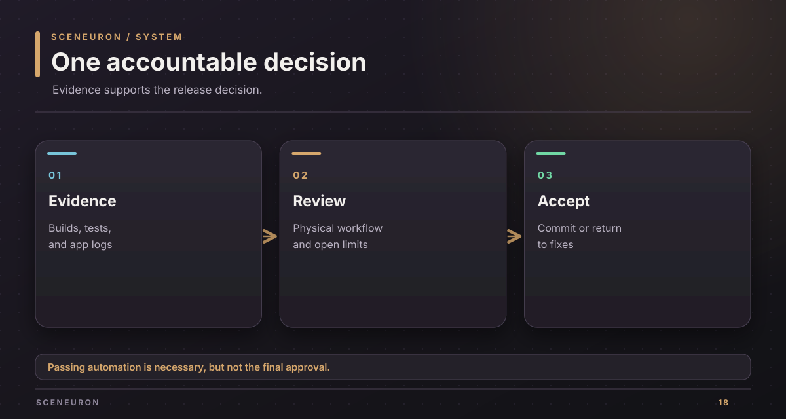

# Current backlog

This list separates implemented behavior from checks and design work that still need a person. It is a current work list, not a dated account of how the project was built.

## Implemented and locally checked

| Area | Present behavior | Check |
| --- | --- | --- |
| Starter setup | A fresh OBS install starts with cards, elements, rules, and separate AI settings. | Workspace tests and browser flow |
| Editor and overlay | The editor saves the project; the overlay follows live state with a limited token. | Browser flow and HTTP tests |
| Professional packs | Meeting, planning poker, classroom, status, subtitles, and live description packs. | Core tests and browser flow |
| Stream Deck | Cards, elements, automation, voice hold, reactions, room controls, and profile layouts. | Plugin tests and live fake-device flow |
| Shared room | Hidden votes, reveal, average, next round, and disconnect handling. | Module tests and throwaway SpacetimeDB flow |
| OBS package | Native macOS library, bundle, notices, signature, and local load. | Release build, package validation, OBS log |
| AI boundaries | Disabled defaults, separate consent and keys, scoped local tokens. | AI, server, and browser tests |

## Before the owner accepts a commit

- Test a real camera and hand signals in OBS, including the case where meeting and poker signals could compete.
- Test a real microphone with consent, push to talk, and spoken cards.
- Use the imported Stream Deck profile on the physical device and watch a card rise and lower in OBS.
- Check a short recording or virtual-camera call for readable cards and subtitles.
- Re-run the [verification checks](verification.md) after any fixes, and review all source and documentation changes.

## Later engineering work

- Make the OBS distribution boundary clear before public shipping. The current binary links libobs and is for private use and demos.
- Extend platform support only after a supported build and test path exists for that platform.
- Validate real cloud-provider plans and translations only with the owner's permission to use keys and credits.
- Keep the room's cross-machine and TLS behavior separate from the passing one-machine test.
- Reconcile the component READMEs with this new documentation. Some still describe older test runs or image output paths. Keep the original `PLAN.md` intact.

Do not infer that a simulated AI check proves a live provider, or that a fake Stream Deck proves the physical device. The [product brief](project-brief.md) describes what users can do; the [verification guide](verification.md) says what has been checked.

Copyright (c) 2026 Alexander Picon, Chaski AI (https://chaski.ai). All rights reserved.
Proprietary software; see [LICENSE](../LICENSE).
