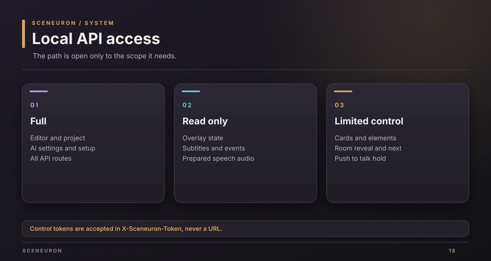
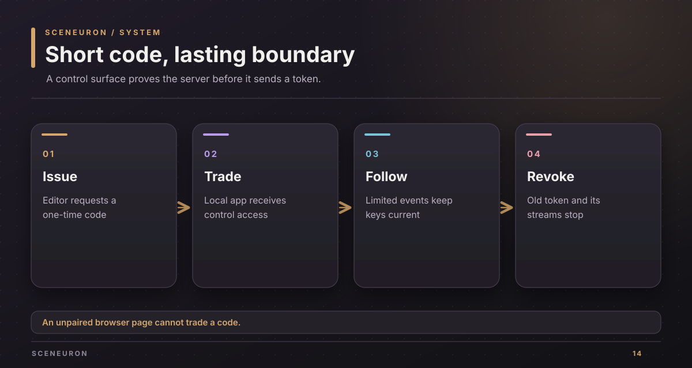

# Local HTTP integration

Sceneuron exposes an HTTP API on `127.0.0.1` for its browser views and local controls. The OBS plugin uses port 4466 by default; `sceneuron-dev --port 0` chooses a free port. This is a local integration surface, not a remote service.

## Prove the server first

Before a client sends a token to a port, request `GET /api/hello?nonce=N` with no token. `N` is 16 to 128 hexadecimal characters. The JSON reply has `editor`, `overlay`, and `control` HMAC-SHA256 proofs for the nonce and port. A client compares the proof for the token it holds before sending that token. This prevents a new process on an old port from receiving a saved control token.

All API requests must use a Host header for `127.0.0.1` or `localhost` with this server's port. Browser pages and assets may load without a token. The API requires one of these scopes:

| Scope | How the client sends it | Allowed work |
| --- | --- | --- |
| Editor | `X-Sceneuron-Token` header, or its page's token query | Full API and project edits |
| Overlay | Token for the overlay URL or a header | Read state, events, subtitles, and spoken-card audio |
| Control | `X-Sceneuron-Token` header only | Limited card, element, automation, effect, voice-hold, and room actions |

The editor token wins when a header and query token are both present. Never put the control token in a URL. Pairing returns it only to a local app after a one-time code is traded.

## Endpoint map

| Area | Methods and paths | Purpose |
| --- | --- | --- |
| Pages | `GET /editor`, `GET /overlay`, `GET /assets/*` | Serve the editor and overlay |
| Project and state | `GET /api/state`, `GET/PUT /api/project`, `GET /api/events` | Read live state, edit the saved project, follow events |
| Cards and elements | `GET /api/packs`, `POST /api/card`, `POST /api/control/element` | Read packs and operate cards or visibility |
| Other controls | `POST /api/override`, `/release`, `/effect`, `/flood`, `/automation` | Hold or release changes and play effects |
| OBS setup | `GET /api/sources`, `POST /api/sources/attach`, `GET /api/audio-sources`, `POST /api/audio-sources/attach`, `POST /api/overlay`, `POST /api/setup` | Choose OBS inputs and set up the scene |
| Camera | `GET /api/camera/preview`, `GET /api/camera/analysis` | Show the editor's camera preview and analysis |
| AI | `GET/PUT /api/ai`, `POST /api/ai/plan`, `POST /api/ai/analyze` | Manage settings and request plans or analysis |
| Voice and subtitles | `GET /api/voice`, `GET /api/voice/guide`, `POST /api/voice/talk`, `POST /api/voice/command`, `GET /api/subtitles`, `POST /api/subtitles/simulate` | Read or operate optional speech features |
| Room | `GET/POST /api/room` | Read room state or act on a round |
| Pairing | `GET/POST /api/control/pairing`, `POST /api/control/pair`, `POST /api/control/revoke` | Issue, trade, or revoke control access |
| Control feed | `GET /api/control/state`, `GET /api/control/events` | Limited control view and events |

The exact route and scope tables live in `crates/sceneuron-server/src/endpoints.rs`. Request body types live beside their handlers. New routes are denied to limited tokens until added to that explicit table.

## Selected requests

### Raise a card

Send JSON to `POST /api/card`:

~~~json
{"deck":"meeting","card":"agree","action":"raise"}
~~~

`deck` is a deck ID string. `card` is a card ID string for `raise` and `toggle`; it is optional for `lower`, `next`, and `previous`. `action` is one of those five strings. A full editor token receives a full snapshot. A control token receives only the control view.

### Change one element

Send JSON to `POST /api/control/element`:

~~~json
{"element":"name-label","action":"toggle"}
~~~

`element` is an existing element ID. `action` is `show`, `hide`, `toggle`, or `release`. A toggle reads and changes visibility in one engine update.

### Hold push to talk

Send `{"down":true}` to `POST /api/voice/talk` when the key goes down, and `{"down":false}` when it goes up. This does not enable voice control or grant consent; those are separate settings.

### Reveal a room

Send `{"action":"reveal"}` or `{"action":"next"}` to `POST /api/room`. A control token may use only these two room actions and receives `{"ok":true}`, without names or votes. The editor may also create, join, open, practice, stop practice, and leave through this path, with the optional fields defined in `crates/sceneuron-server/src/room.rs`.

### Pair a control surface

The editor requests a code with `POST /api/control/pairing`. It expires and replaces any earlier code. A local app sends `{"code":"123456"}` to `POST /api/control/pair` and receives a control token if the code is valid. Web-page origins are refused. `POST /api/control/revoke` replaces the control token and ends old event streams.

## Common errors

| Status | Condition | Client response |
| --- | --- | --- |
| 400 | Invalid JSON, unknown request field, or invalid value | Fix the request; do not retry unchanged data. |
| 401 | Missing or invalid token for a private API path | Obtain the right token or pair again. |
| 403 | Wrong token scope, Host header, or pairing origin | Use a route allowed for that client. |
| 404 | Unknown route or audio that is not ready | Check the path or wait for generated audio. |
| 405 | Method is not supported | Read the Allow response header. |
| 413 | JSON body exceeds 256 KiB | Reduce the body size. |
| 500 | Server handler failure | Inspect the local log; retry only after checking state. |

Copyright (c) 2026 Alexander Picon, Chaski AI (https://chaski.ai). All rights reserved.
Proprietary software; see [LICENSE](../LICENSE).
