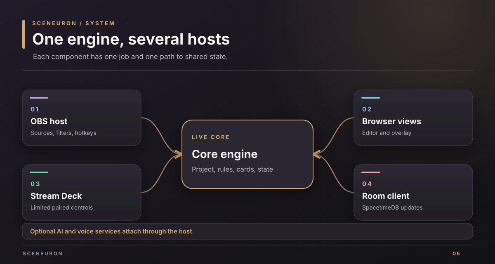
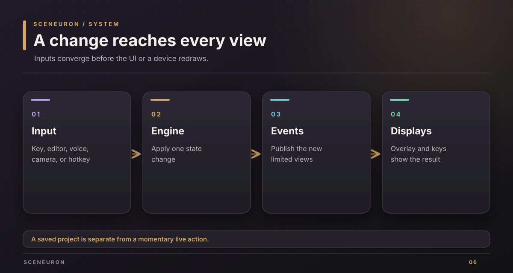
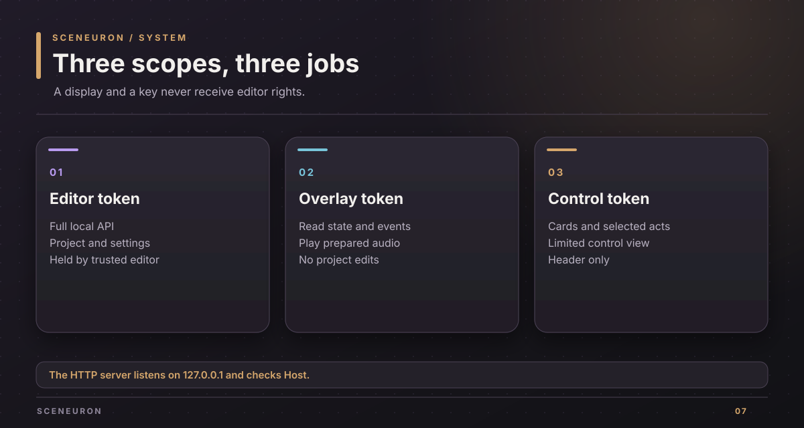
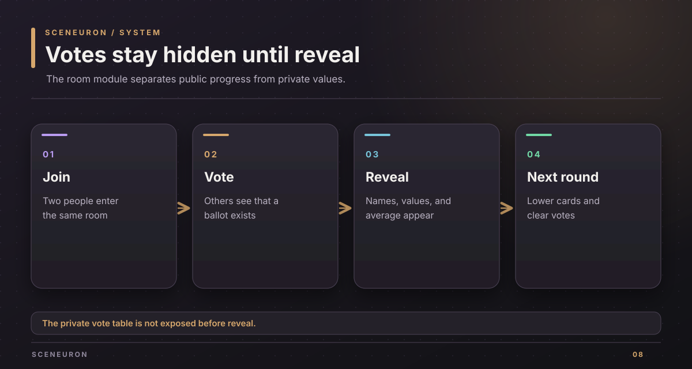

# System design

Sceneuron keeps one live project and a set of runtime states in a Rust engine. OBS, the browser editor, the overlay, and Stream Deck adapt that state for different jobs.

## Components

| Component | Responsibility | Source |
| --- | --- | --- |
| Core engine | Project model, cards, decks, rules, packs, hand signals, subtitles state, and overrides | `crates/sceneuron-core/` |
| OBS module | OBS lifecycle, sources, filters, hotkeys, on-air state, and the local host bridge | `crates/sceneuron-obs/` |
| OBS bindings | The libobs and frontend functions used by the module | `crates/sceneuron-obs-sys/` |
| Local server | Editor assets, API routes, token scopes, state events, and control views | `crates/sceneuron-server/` |
| Vision | Frame conversion and face and hand analysis on the Mac | `crates/sceneuron-vision/` and `crates/sceneuron-vision-apple/` |
| Optional AI and voice | Provider settings, camera understanding, assistant plans, speech recognition, and speech output | `crates/sceneuron-ai/` and `crates/sceneuron-voice/` |
| Shared room client | Connection to the room server and translation of room events into live state | `crates/sceneuron-room/` |
| Browser views | The editable project and the limited live overlay | `web/editor/` and `web/render*.js` |
| Stream Deck plugin | Keys, dial, profile, pairing, and local control requests | `streamdeck/` |
| Room module | Private votes and public room state in SpacetimeDB | `room/module/` |

The macOS OBS module is a dynamic library. The development server, `sceneuron-dev`, hosts the same core and local server without OBS. Its simulated camera and AI make browser tests possible without devices or cloud requests.

## State changes

An action from a key, hotkey, editor, voice command, or camera signal enters the engine. The engine updates its state once. Listeners then refresh OBS controls, the overlay, and control surfaces. The editor saves project edits; runtime actions do not silently rewrite the project layout.

The overlay receives a read-only state and event stream. A Stream Deck receives a smaller control view that leaves out captions, AI settings, heard speech, and the event log. A card key can therefore draw the current card without gaining editor rights.

## Local trust boundary

The HTTP server binds to `127.0.0.1` and checks the Host header. It uses three distinct tokens:

| Token | Holder | Access |
| --- | --- | --- |
| Editor | Editor page and trusted local user | Full API |
| Overlay | OBS browser source | State, events, subtitles, and spoken-card audio |
| Control | Paired Stream Deck or another control surface | Cards, element control, automation, selected effects, push to talk, and limited room actions |

The control token is accepted only in the `X-Sceneuron-Token` header. It does not go in a URL. Pages and control surfaces first ask `GET /api/hello` to prove that the server on a port holds their token. Revoking the control token ends its event streams and prevents further actions. See the [local API guide](control-api.md).

## Files and secrets

The OBS module stores `project.json`, `server.json`, `ai.json`, and an optional `.env` in its own configuration directory. `server.json` holds local tokens. `ai.json` holds provider settings and may hold keys. The two secret-bearing files are written privately for the local owner. The project layout is separate from AI credentials.

The development server keeps the default project in memory unless given `--project PATH`. With a new project path it starts from the starter setup. Local `.env` is ignored by Git; `.env.example` lists the optional variable names.

## Optional external flows

- Camera understanding sends selected frames to the configured AI provider only after the user enables it and consents.
- Jev receives text facts rather than camera images when configured.
- ElevenLabs receives microphone audio only for enabled, consented voice or subtitle use. Spoken cards send the line to speak.
- SpacetimeDB holds shared room state. The vote table is private until a reveal copies results into public room state.

The room module runs separately from the OBS plugin. Sceneuron's room client speaks SpacetimeDB's WebSocket protocol; the module is built for WebAssembly and has its own lockfile.

## Failure behavior

A missing cloud key leaves the matching feature off while local controls continue. A lost room connection leaves or reports the room state without blocking local cards. A bad or absent API token is refused before a private API route is exposed. When OBS exits, its local server and bridges stop with the module.

Implementation contracts: `crates/sceneuron-server/src/endpoints.rs`, `access.rs`, `hello.rs`, `crates/sceneuron-obs/src/plugin.rs`, and the room client and module tests.

Copyright (c) 2026 Alexander Picon, Chaski AI (https://chaski.ai). All rights reserved.
Proprietary software; see [LICENSE](../LICENSE).
