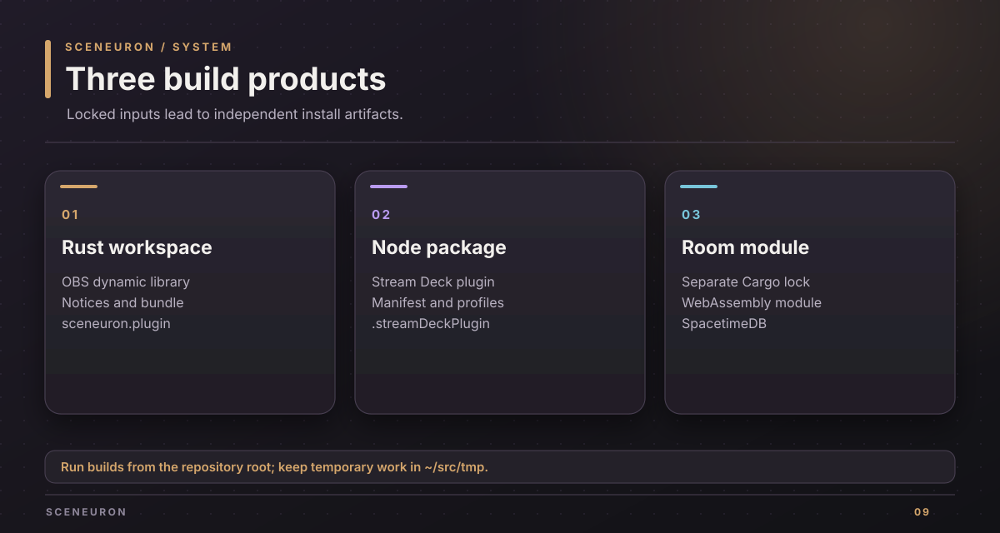
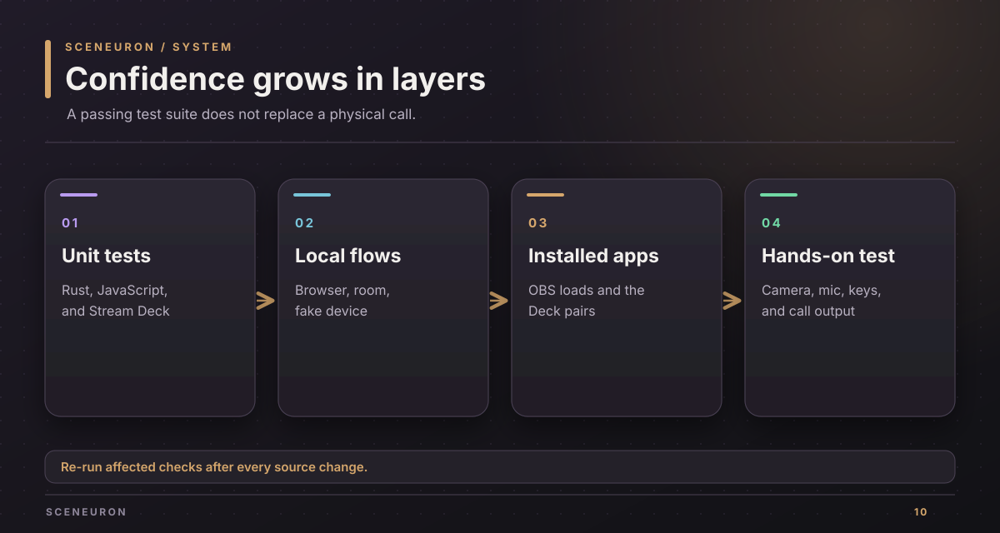

# Development guide

Use this guide when changing Sceneuron code on a Mac. Run commands from the repository root. Keep build output and temporary test work inside `~/src/`.

## Prerequisites

| Tool | Needed for |
| --- | --- |
| macOS 13 or newer and Xcode command line tools | The OBS plugin and Apple Vision code |
| Rust 1.91 or newer | The workspace |
| Rust 1.96 or newer and the `wasm32-unknown-unknown` target | The room module |
| Node.js 24 or newer and npm | Browser tests and the Stream Deck plugin |
| OBS Studio 31.1 or newer | Running the OBS plugin |
| Stream Deck 7.1 or newer | Running the Stream Deck plugin |
| Chrome or Chromium, ffmpeg with libx264, and SpacetimeDB 2.10.2 | The matching optional live tests |

Both Cargo workspaces have committed lockfiles. The Stream Deck package has `package-lock.json` and a local `.npmrc` that saves exact versions, blocks install scripts, and applies a release-age gate.

## Start without OBS

1. Build the development server:

   ~~~sh
   cargo build --locked -p sceneuron-dev
   ~~~

   Expect `target/debug/sceneuron-dev`.

2. Start the simulated camera and AI on a free local port:

   ~~~sh
   cargo run --locked -p sceneuron-dev -- --port 0 --demo-presence --demo-ai
   ~~~

   Expect printed Editor and Overlay URLs. Open the Editor URL. The simulated AI sends no camera image or key to a provider.

3. Stop the server with Ctrl-C. A project is saved only if you supplied `--project PATH`.

## Run the core checks

Run each command from the root. A successful command exits with status zero.

~~~sh
cargo fmt --all -- --check
cargo test --locked --workspace
cargo clippy --locked --workspace --all-targets -- -D warnings
node --test 'web/tests/*.test.mjs' 'e2e/tests/*.test.mjs'
~~~

The independent room module has its own lockfile:

~~~sh
cargo fmt --manifest-path room/module/Cargo.toml --check
cargo test --locked --manifest-path room/module/Cargo.toml
cargo clippy --locked --manifest-path room/module/Cargo.toml --target wasm32-unknown-unknown -- -D warnings
~~~

For the Stream Deck code:

~~~sh
npm --prefix streamdeck ci
npm --prefix streamdeck run check
npm --prefix streamdeck test
npm --prefix streamdeck run validate
~~~

## Run local integration checks

Build `sceneuron-dev` first. Set a temporary root inside `~/src/tmp/` so a failed run leaves its work there for inspection:

~~~sh
mkdir -p ~/src/tmp/sceneuron-tests
TMPDIR=~/src/tmp/sceneuron-tests node e2e/editor-browser.mjs
TMPDIR=~/src/tmp/sceneuron-tests node e2e/streamdeck-live.mjs
TMPDIR=~/src/tmp/sceneuron-tests node e2e/room-live.mjs
~~~

The browser flow uses simulated AI and Chrome. The Stream Deck flow uses a fake device against the real development server. The room flow starts a throwaway SpacetimeDB on a free loopback port and publishes `room/module` there.

To rebuild the documentation diagrams after editing their layout data, run `node scripts/docs/diagrams.mjs` from the root. The SVGs under `docs/graphics/` are the rendered outputs and carry the same copyright notice as other project SVGs.

The OBS script `node e2e/run.mjs --plugin dist/macos/sceneuron.plugin` starts an isolated OBS with an unauthenticated test obs-websocket endpoint on all network interfaces. Run that script only on a trusted or firewalled network. The [verification guide](verification.md) separates this script from the live-app checks.

## AI providers

Google Gemini is the default configured provider. An OpenAI-compatible endpoint is an alternative. Optional keys are `SCENEURON_GEMINI_API_KEY`, `SCENEURON_OPENAI_API_KEY`, `SCENEURON_JEV_API_KEY`, and `SCENEURON_ELEVENLABS_API_KEY`. Copy `.env.example` to an untracked `.env` only for the features you use. A key saved in the editor takes priority for its provider.

The real provider paths can spend credits. The default test commands above use local fakes or simulation. Opt-in voice and subtitle live scripts are documented in [e2e/README.md](../e2e/README.md).

## Dependencies and license

### License gate

The OBS package includes third-party notices. Check the two macOS dependency graphs before packaging:

~~~sh
cargo run --locked -p sceneuron-notices -- --check --target aarch64-apple-darwin --target x86_64-apple-darwin
~~~

The check rejects a shipped crate whose license is outside the allowed set or cannot be read. Generate the notices file for a build with `sceneuron-notices --target TRIPLE --out PATH`. The OBS package also includes the UltraFace model notice. The Stream Deck bundle writes notices for its npm dependencies during its build.

| Allowed SPDX IDs | Reason for the gate |
| --- | --- |
| `MIT`, `BSD-2-Clause`, `BSD-3-Clause`, `ISC`, `Zlib` | Permissive terms that require their notices to travel with the binary. |
| `0BSD`, `CC0-1.0` | Permissive terms or a public-domain dedication with a fallback. |
| `Apache-2.0` | Permissive, but a distributed binary that combines it with libobs's GPL-2.0-or-later would need a compatible GPL version. |
| `Unicode-3.0`, `Unicode-DFS-2016` | Permissive terms for Unicode data and code; keep the notice. |
| `IJG` | JPEG code with a documentation credit requirement, carried in the notices. |
| `CDLA-Permissive-2.0` | Certificate data whose agreement text travels with the bundle. |

An `OR` expression needs an allowed branch, and every branch of an `AND` expression must be allowed. A license-file-only declaration is refused because the gate cannot classify it. The list is defined in `crates/sceneuron-notices/src/gate.rs` and checked against this section by a test.

Sceneuron itself is proprietary under [LICENSE](../LICENSE). The current OBS binary links libobs, so its package is for private use and demos, not public distribution in its current form. The [backlog](backlog.md) keeps the distribution boundary visible.

## Recover a failed run

Read the failing command and its work directory before changing code. Stop any test process it left running. Keep only the failure artifacts needed for diagnosis under `~/src/tmp/`. Re-run the smallest failing command, then the affected suite. The [verification guide](verification.md) gives the release check order.

Copyright (c) 2026 Alexander Picon, Chaski AI (https://chaski.ai). All rights reserved.
Proprietary software; see [LICENSE](../LICENSE).
