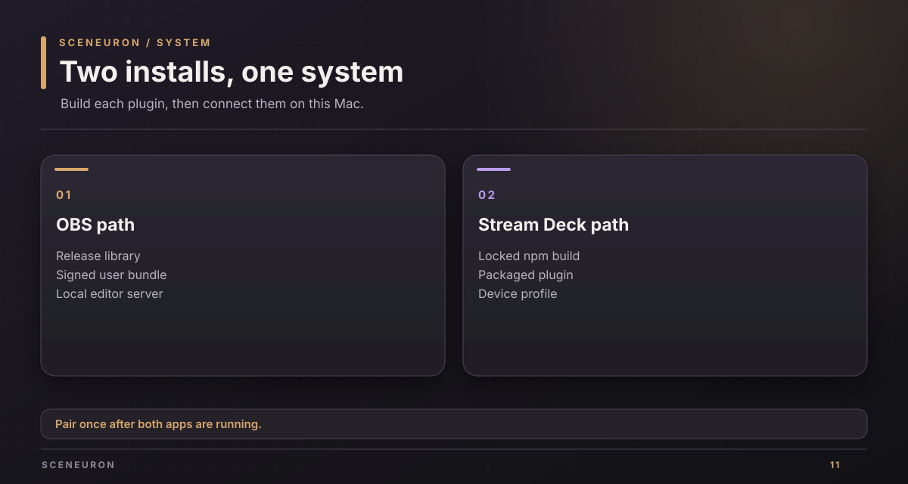
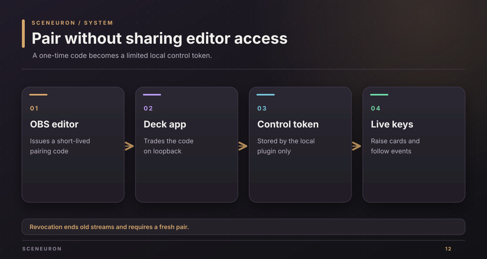

# Install Sceneuron on a Mac

Use this guide to install the OBS and Stream Deck plugins for a local test. The OBS plugin is for the owner's own use and demos under the current [license boundary](development.md#license-gate).

## Prerequisites

Use macOS 13 or newer, OBS Studio 31.1 or newer, and Stream Deck 7.1 or newer. Build with Rust 1.91 or newer, Xcode command line tools, Node.js 24 or newer, and npm. The commands below start in the repository root.

Quit OBS before replacing its bundle. Keep the Stream Deck app available for its install prompt. Keep any previous OBS bundle until the new one loads.

## Build the OBS bundle

1. Build the native library for this Apple silicon Mac:

   ~~~sh
   MACOSX_DEPLOYMENT_TARGET=13.0 cargo build --release --locked -p sceneuron-obs
   ~~~

   Expect `target/release/libsceneuron.dylib`.

2. Write the required third-party notices into a task directory:

   ~~~sh
   mkdir -p ~/src/tmp/sceneuron-notices
   cargo run --locked -p sceneuron-notices -- --target aarch64-apple-darwin --out ~/src/tmp/sceneuron-notices/notices.txt
   ~~~

   Expect a nonempty `notices.txt`.

3. Package and verify:

   ~~~sh
   scripts/package.sh --lib target/release/libsceneuron.dylib --os macos --version 0.1.0 --notices ~/src/tmp/sceneuron-notices/notices.txt --out dist/macos
   codesign --verify --deep --strict dist/macos/sceneuron.plugin
   ~~~

   Expect `dist/macos/sceneuron.plugin` and `dist/macos/sceneuron-0.1.0-macos-arm64.zip`.

4. Copy the bundle into OBS's user plugin folder:

   ~~~sh
   mkdir -p "$HOME/Library/Application Support/obs-studio/plugins"
   ditto dist/macos/sceneuron.plugin "$HOME/Library/Application Support/obs-studio/plugins/sceneuron.plugin"
   ~~~

   If an older `sceneuron.plugin` is there, first move it to a backup under `~/src/tmp/`. Avoid merging the new bundle into old files.

5. Start OBS. In Tools > Plugin Manager, look for Sceneuron. Its current log should include `[sceneuron] loaded version 0.1.0` and an editor address on `127.0.0.1`. The default port is 4466.

## Build and install Stream Deck

1. Install the locked dependencies and check the plugin:

   ~~~sh
   npm --prefix streamdeck ci
   npm --prefix streamdeck run check
   npm --prefix streamdeck test
   npm --prefix streamdeck run validate
   npm --prefix streamdeck run package
   ~~~

   Expect `streamdeck/dist/ai.chaski.sceneuron.streamDeckPlugin`.

2. Open that package file with Stream Deck and accept its install prompt. The plugin appears as Sceneuron in the action list.

3. If Stream Deck did not import a profile, open `streamdeck/ai.chaski.sceneuron.sdPlugin/profiles/sceneuron-stream-deck-xl.streamDeckProfile` for an XL, or `sceneuron-stream-deck.streamDeckProfile` for a 15-key device. Confirm the profile import and select it on the device.

The plugin includes Raise a card, Lower cards, Show or hide, Pause automation, Push to talk, Reveal votes, Next round, and Reaction keys. A card dial is available on devices with an encoder.

## Pair the two plugins

OBS starts the editor on loopback. Its first-start pairing path gives an installed Stream Deck plugin time to reconnect, then sends a one-time pairing link if no deck has connected. The editor's Set up OBS for me action can send a link immediately. A code can also be entered through a key's property inspector.

Expect the Stream Deck log to say it paired with Sceneuron on the OBS port. A paired key can raise a card without receiving the editor's full API token. Open the imported profile and press one card key while watching the OBS overlay.

## Verify and recover

| Check | Expected result | If it fails |
| --- | --- | --- |
| OBS log | `loaded version 0.1.0` and an editor address | Confirm OBS is supported, the bundle path, architecture, and code signature. |
| Stream Deck action list | Sceneuron actions appear | Restart Stream Deck and check its Plugins folder. |
| XL or 15-key profile | The matching Sceneuron profile is listed | Open its `.streamDeckProfile` file and confirm import. |
| Pairing | The plugin log reports the OBS port | Use Set up OBS for me or enter a fresh pairing code. |
| Physical key | A card rises and lowers in OBS | Check that the profile is active, both apps run, and pairing succeeded. |

To roll back OBS, quit it and restore the bundle you backed up. To remove the Stream Deck plugin, use Stream Deck's plugin controls; a development link can instead be removed with `streamdeck unlink ai.chaski.sceneuron`. An imported profile is separate from the plugin and can be removed in Stream Deck's profile settings.

The [verification guide](verification.md) lists the rest of the hands-on checks.

Copyright (c) 2026 Alexander Picon, Chaski AI (https://chaski.ai). All rights reserved.
Proprietary software; see [LICENSE](../LICENSE).
