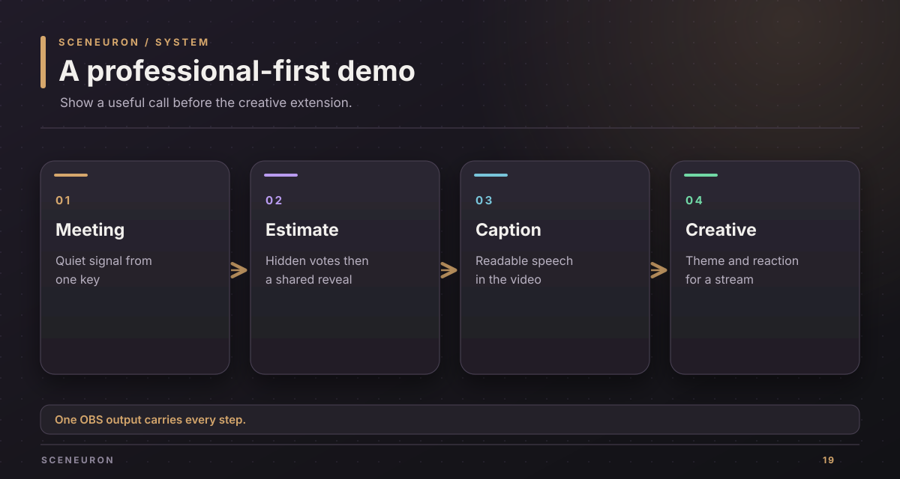
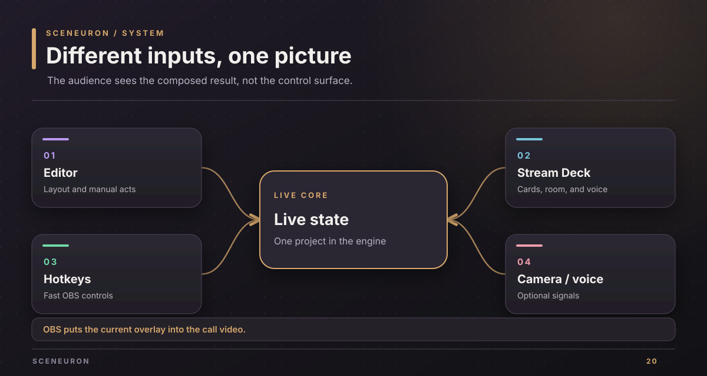

# Demo guide

Lead with a professional video call. Sceneuron lets one person show meeting and classroom signals, run a planning poker round, and put captions in their video without interrupting the call. The same overlay can become a creative stream graphic.

## The problem to show

In a call, a quiet participant needs a way to ask a question, signal that the meeting is off track, or vote on an estimate. Chat and reactions are separate from the person's video. A physical control can be faster than finding a browser tab.

Sceneuron puts these signals in OBS's composed output. The participant can keep the same controls in a meeting app through OBS Virtual Camera.

## A short live demo

1. Start OBS with the Sceneuron overlay and show the imported Stream Deck profile.
2. Raise a Meeting signals card from a physical key. Show the same card in the editor and on the virtual-camera output.
3. Lower it, then raise a Planning poker value. Join a shared room from a second client, cast a hidden vote, reveal both values and the average, and start the next round.
4. Turn on subtitles with the needed consent and show a short spoken line. Use a simulated line if a live microphone is not part of the demo.
5. Switch the overlay theme. Explain that the same canvas can be used for a stream reaction or on-air status without changing the professional controls.

## What to say accurately

- The local editor, cards, hotkeys, OBS overlay, and Stream Deck do not need a cloud AI key.
- Camera understanding, speech recognition, spoken cards, and translations are separate optional services with consent and provider settings.
- The shared room uses SpacetimeDB. Vote values remain private until reveal.
- The current OBS plugin targets macOS and has been loaded in OBS. A physical camera, microphone, and Stream Deck remain the final manual checks.

Keep an untested provider or device out of the live path. The [verification guide](verification.md) names the evidence for each step. The [provenance page](provenance.md) records the owner's account of the plan and implementation.

Copyright (c) 2026 Alexander Picon, Chaski AI (https://chaski.ai). All rights reserved.
Proprietary software; see [LICENSE](../LICENSE).
