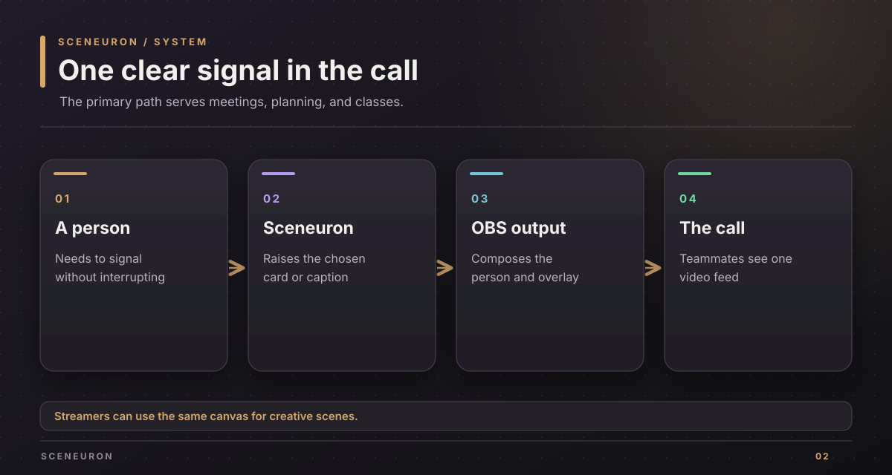
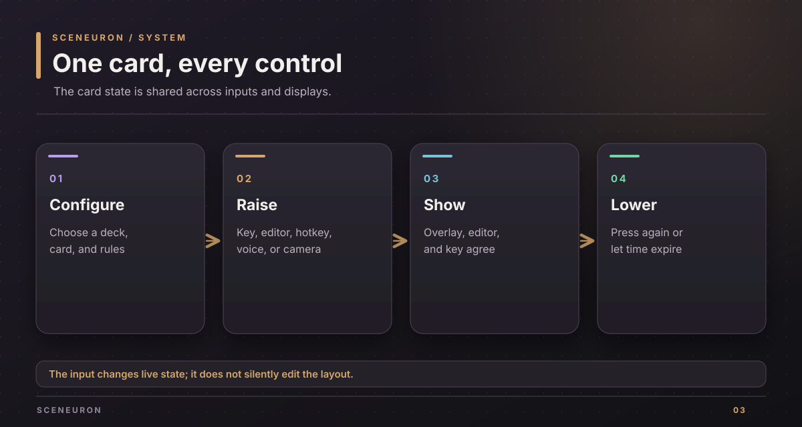

# Product brief

Sceneuron gives a person in a video call clear visual signals without asking them to interrupt the conversation. It runs inside OBS Studio, so its output can appear in a meeting app through OBS Virtual Camera. Streamers can use the same controls for live scenes and playful reactions.

## Primary use

| Situation | Available response |
| --- | --- |
| A meeting needs a quick signal | Raise a Meeting signals card such as Wrap it up, I have a question, Agree, or Disagree. |
| A team estimates work | Show a Planning poker card, collect hidden votes in a shared room, then reveal the people, values, and average. |
| A class needs feedback | Raise a Classroom card such as a question, a request to repeat, or an answer. |
| People need readable speech | Show live subtitles in the spoken language, with optional translations. |
| A participant needs a consistent on-screen identity | Edit text, labels, frames, and card positions in the browser editor. |

Cards can be raised from the editor, OBS hotkeys, a Stream Deck, a voice command, or a configured camera signal. The source of the action does not change the card's live state. A deck can lower its current card by hand or when its timeout expires.

## The editor and overlay

The browser editor manages elements, decks, cards, rules, themes, AI settings, microphone choice, subtitles, and room controls. The overlay is a separate browser view intended for an OBS source. It follows state changes without gaining edit access. Themes include Graphite, Hacker, 80s computer, Classic Mac, Vaporwave, Windows 95, and None.

A new OBS install starts with a starter project and starter AI settings. The starter includes meeting, planning poker, classroom, and status decks, a subtitles area, and rules. The editor's Set up OBS for me action adds missing OBS pieces; it does not choose a camera source for the user.

## Optional intelligence

On-device vision detects presence, faces, and hand signals. Camera understanding can send selected frames to Google Gemini or an OpenAI-compatible endpoint when the user enables it and consents. Jev can judge conditions from local text facts without receiving camera images. ElevenLabs can supply speech recognition and spoken cards. A key is needed only for the cloud feature that uses it.

The AI provider, voice control, and subtitles have separate controls. Voice control and subtitles do not start recording the microphone merely because a key exists. The [system design](design.md) shows the data boundaries.

## Shared room

The room feature uses a separate SpacetimeDB module. A participant's vote remains private until the reveal. Other participants can see that someone voted, but not the value. The reveal publishes the values and average together. The next round clears the votes.

## Creative use

A streamer can use the same cards as stream graphics, add on-air labels and timers, choose a visual theme, trigger a reaction flood, or connect a Stream Deck. These uses extend the professional workflow; they do not change the local control or consent model.

## Current boundaries

- The OBS plugin supports macOS, with OBS Studio 31.1 or newer.
- The Stream Deck plugin supports macOS 13 or newer and Stream Deck 7.1 or newer.
- A real camera, real microphone, and physical Stream Deck still need a person to test the final call workflow.
- The OBS plugin binary is for the owner's own use and demos under the current licensing arrangement. See [development](development.md#license-gate).

Implementation sources: `crates/sceneuron-core/src/packs/`, `crates/sceneuron-obs/src/`, `crates/sceneuron-ai/src/`, `streamdeck/ai.chaski.sceneuron.sdPlugin/manifest.json`, and `room/module/src/`.

Copyright (c) 2026 Alexander Picon, Chaski AI (https://chaski.ai). All rights reserved.
Proprietary software; see [LICENSE](../LICENSE).
