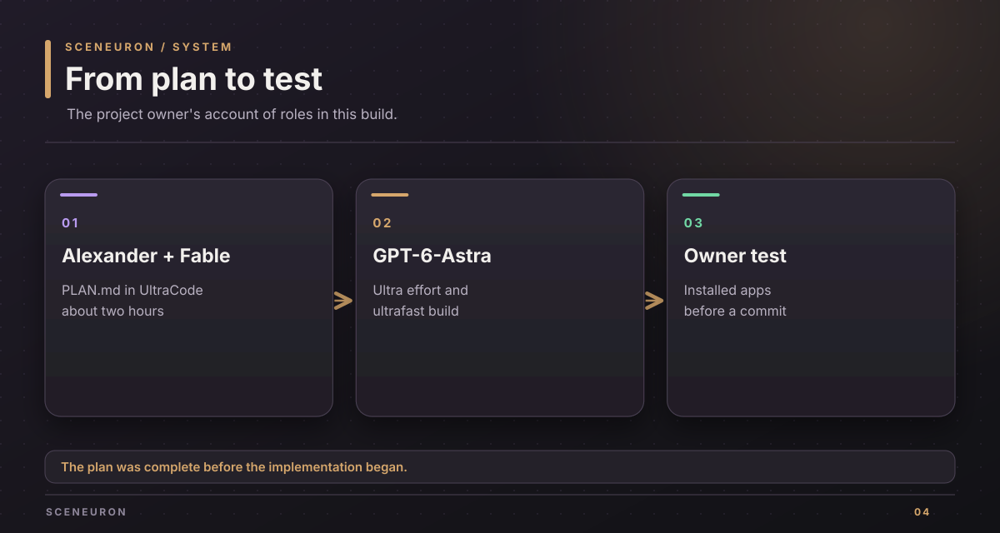

# Project provenance

This page records the project owner's account of how the plan and implementation were produced. It describes work roles, not the identity fields stored in Git commits.

## Owner account

Alexander Picon spent a couple of hours creating `PLAN.md` with Fable 5.1 on UltraCode. Once the plan was complete, GPT-6-Astra implemented it with ultra effort and ultrafast enabled to meet the deadline.

Alexander set the product direction and will test the installed OBS and Stream Deck plugins before the new project files are committed. This testing gate is separate from automated builds and from the author and committer metadata of the existing Git commit.

Alexander also designed the final interface in Figma. The diagrams in this documentation use original SVG artwork and the dark surfaces, rounded panels, and accent colors visible in the current interface code. They are documentation graphics, not exports of the Figma frame.

## What the repository records

`PLAN.md` is the first committed file. The other project files and this documentation are currently working-tree material pending the owner's test. Build output, local keys, and installed plugin copies are not source commits.

The [verification guide](verification.md) records the checks needed before the owner accepts a commit candidate. The [product brief](project-brief.md) describes what the resulting product does.

Copyright (c) 2026 Alexander Picon, Chaski AI (https://chaski.ai). All rights reserved.
Proprietary software; see [LICENSE](../LICENSE).
