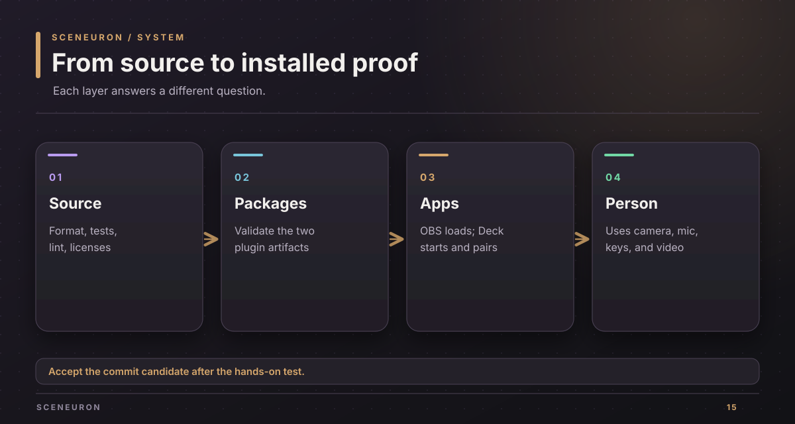
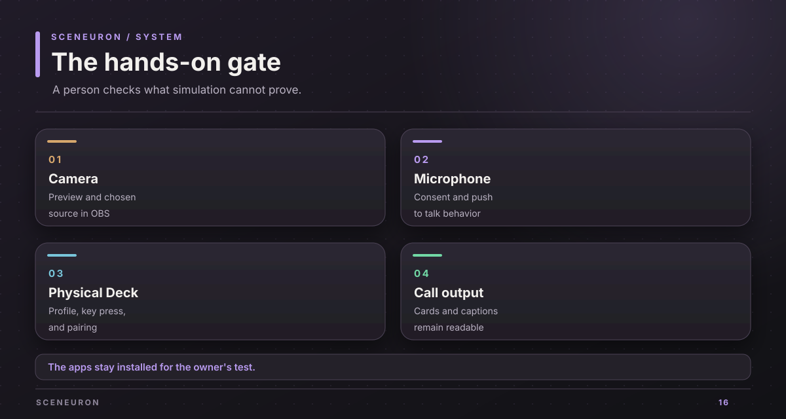

# Verification guide

Use this guide before accepting a commit candidate. Automated checks prove code paths; the last gate is a hands-on test in OBS and on the physical Stream Deck.

## Automated checks

Run from the repository root. A command passes only when it exits with status zero.

| Area | Command | Expected result |
| --- | --- | --- |
| Rust style | `cargo fmt --all -- --check` | No formatting diff |
| Rust workspace | `cargo test --locked --workspace` | All workspace unit and integration tests pass |
| Rust lint | `cargo clippy --locked --workspace --all-targets -- -D warnings` | No warnings |
| Browser helpers | `node --test 'web/tests/*.test.mjs' 'e2e/tests/*.test.mjs'` | All runnable tests pass; declared skips are reported |
| Room rules | `cargo test --locked --manifest-path room/module/Cargo.toml` | Module rule tests pass |
| Stream Deck | `npm --prefix streamdeck test` and `npm --prefix streamdeck run check` | Tests and type check pass |
| Stream Deck package | `npm --prefix streamdeck run validate` and `npm --prefix streamdeck run package` | Validation succeeds and package is written |
| License gate | `cargo run --locked -p sceneuron-notices -- --check --target aarch64-apple-darwin --target x86_64-apple-darwin` | Every shipped crate has an allowed license |

The current copied workspace passed these commands, the Stream Deck test suite, the browser flow, the Stream Deck live flow, and the real local room flow. These are preparation results; re-run affected checks after code changes.

## Local integration

Build `sceneuron-dev` and run the three local flows with `TMPDIR` inside `~/src/tmp/`:

~~~sh
cargo build --locked -p sceneuron-dev
mkdir -p ~/src/tmp/sceneuron-tests
TMPDIR=~/src/tmp/sceneuron-tests node e2e/editor-browser.mjs
TMPDIR=~/src/tmp/sceneuron-tests node e2e/streamdeck-live.mjs
TMPDIR=~/src/tmp/sceneuron-tests node e2e/room-live.mjs
~~~

The browser flow checks the editor and overlay with simulated AI. The Stream Deck flow checks pairing, keys, dial, reactions, and revocation against a real local server and a fake device. The room flow checks a throwaway SpacetimeDB with two Sceneuron instances.

## Installed app checks

1. Build the OBS bundle and Stream Deck package with the [installation guide](install.md). Confirm both bundles validate.
2. Start OBS and confirm `[sceneuron] loaded version 0.1.0` in its log. Confirm it listens on `127.0.0.1`.
3. Install the Stream Deck plugin and the profile that fits the device. Confirm Sceneuron appears in the action list.
4. Confirm the Stream Deck plugin log reports a successful pairing to the OBS port.
5. In the editor, choose a real camera and microphone. Check the preview, consent controls, and the selected sources.
6. Raise and lower a card from the physical Stream Deck. Confirm the overlay, hotkey, and editor all report the same card.
7. If testing a shared room, create a room, vote from two clients, confirm the value is hidden, reveal, and start the next round.
8. Start a short local recording or virtual-camera call and confirm text remains readable at call size.

The OBS log and Stream Deck log have confirmed load and automatic pairing in this workspace. A physical camera, microphone, and Stream Deck still need a hands-on check before a commit.

## Checks with special conditions

The scripted real-OBS proof, `node e2e/run.mjs --plugin dist/macos/sceneuron.plugin`, starts an isolated OBS but opens its test obs-websocket endpoint without a password on all network interfaces. Use it only on a trusted or firewalled network. The live provider scripts under `e2e/` may spend API credits and are separate from the default local checks.

If a check fails, save its exact output and work directory, fix the cause, re-run that check, then re-run its affected suite. Do not treat a previous pass as evidence for changed files.

Copyright (c) 2026 Alexander Picon, Chaski AI (https://chaski.ai). All rights reserved.
Proprietary software; see [LICENSE](../LICENSE).
